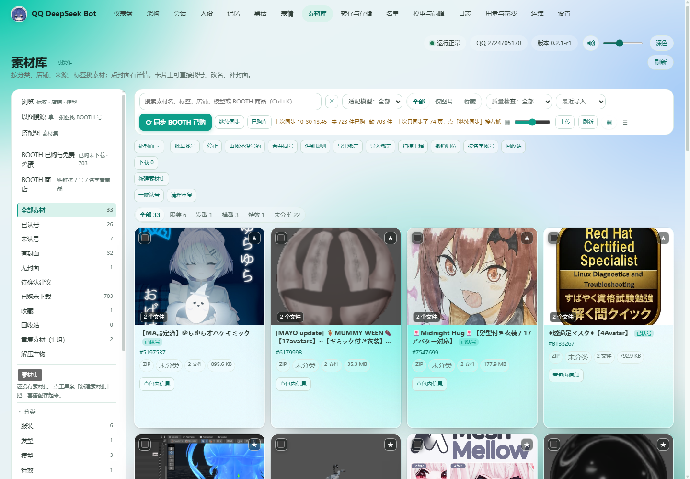
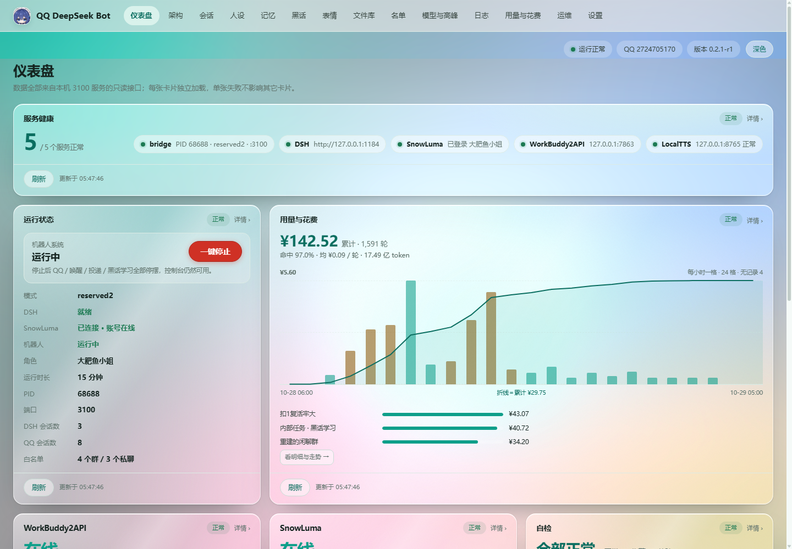
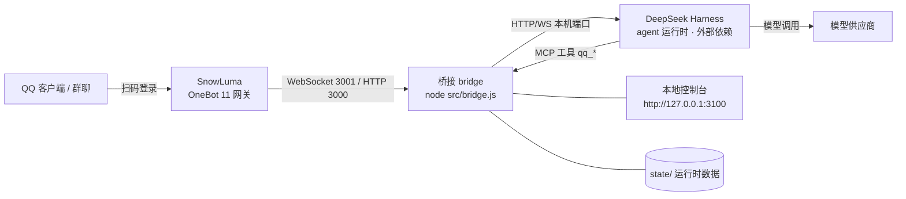

# QQ ↔ DeepSeek Harness 桥接（qq-bridge）

**English**: [README.en.md](README.en.md) | **中文**：就是本页

> 把 QQ 接到 DeepSeek Harness（DSH）的本地桥接：让 AI 以「一个群友」的身份在群聊/私聊里聊天、看图看视频、发表情发语音发图、学黑话、记事儿，并自带本地 Web 控制台与 BOOTH 素材库。
>
> 不是腾讯 / DeepSeek 官方产品（Not affiliated with Tencent or DeepSeek）。DSH、SnowLuma、模型端点都**不随包**，需自己安装。



<details>
<summary>更多截图（控制台首页 / 素材库 Pro）</summary>




</details>

## 它能做什么

群聊/私聊自动聊天（自主决定回不回、何时潜水）、主动接话与连发、看图看视频（抽帧 + 语音转写）、表情包、语音与 TTS/STT、生图两档（均带「AI生成」标注）、记忆与跨会话检索、黑话学习、人设/角色卡、私聊群聊白名单与模型路由、token 用量与花费、BOOTH 素材库（同步已购库 / 下载 / 解压 / 以图搜源 / 认号 / 重复素材 / 素材集 / Unity 工程统计）、群文件转存、本地控制台、访客只读模式、联网搜索……

完整清单（16 条，每条都标了对应配置与文档）见 **[docs/系统介绍.md](docs/系统介绍.md)**。

## 快速开始（3 行）

```powershell
powershell -NoProfile -ExecutionPolicy Bypass -File scripts\bootstrap.ps1   # 装依赖 + 生成 config.json
node scripts\setup-doctor.mjs                                               # 体检：哪项没配、怎么修
npm start                                                                   # 启动，然后打开 http://127.0.0.1:3100/?token=<state/console-token>
```

最小配置只有 4 个值：SnowLuma 的 `wsUrl/httpUrl/accessToken`、DSH 的 `baseUrl/provider/model`、`allow.groups`、`ownerQQ`。详见 **[docs/QUICKSTART.md](docs/QUICKSTART.md)**。

## 版本与 DSH 兼容

当前版本 **v0.2.1-r1**，适配 **DSH 0.2.1-rc.2**（0.2.0-rc.2 亦兼容；`npm run verify:adaptation` 逐项实测）。DSH 代次不兼容时的对应 tag：

| DSH 版本 | 用哪个 tag |
|---|---|
| 0.2.1 / 0.2.0 | `main`（v0.2.1-r1） |
| 0.1.7-rc.2 | `v0.1.7` |
| 0.1.5-rc.1 | `v0.1.5` |
| ≤ 0.1.1-rc.2 | `v0.1.0` |

> 鉴权用 `~/.dsh` 里持久化的浏览器会话签名密钥离线铸造 Cookie（DSH 0.1.7 起进程 token 只在内存）。逐条改动见 [docs/guides/DSH_021_ADAPTATION.md](docs/guides/DSH_021_ADAPTATION.md) 与 [docs/guides/DSH_020_ADAPTATION.md](docs/guides/DSH_020_ADAPTATION.md)。
> 视频介绍：[AI 仿真群友 - 项目介绍视频](https://github.com/Derpyu520/qq-bridge/releases/download/v0.1.5/project-intro.mp4)（Release 附件，不在仓库里）。

## 文档导航

| 我想…… | 看这个 |
|---|---|
| 先搞懂这是什么、架构、配置、隐私、FAQ | **[docs/系统介绍.md](docs/系统介绍.md)** |
| 5 分钟在干净机器上跑起来 | [docs/QUICKSTART.md](docs/QUICKSTART.md) |
| 用 BOOTH 素材库（认号/找号/下载/解压/对账/排障） | [docs/BOOTH-LIBRARY-GUIDE.md](docs/BOOTH-LIBRARY-GUIDE.md) |
| 全部配置项 | [docs/CONFIG-FIELDS.md](docs/CONFIG-FIELDS.md) |
| 目录/脚本职责 | [docs/FOLDER_MAP.md](docs/FOLDER_MAP.md) |
| 把桥接接进目标设备的 DSH | [docs/guides/DSH_SETUP.md](docs/guides/DSH_SETUP.md) |
| 安全边界与威胁模型 | [docs/guides/SECURITY_BASELINE.md](docs/guides/SECURITY_BASELINE.md)、[RULES.md](RULES.md) |
| 许可证与再分发边界 | [docs/开源说明.md](docs/开源说明.md)、[docs/THIRD-PARTY.md](docs/THIRD-PARTY.md)、[LICENSE](LICENSE) |
| 桌面壳（Windows 托盘客户端） | [docs/desktop-host.md](docs/desktop-host.md) |
| 完整文档索引 | [docs/README.md](docs/README.md) |

## 架构



## 目录结构

| 路径 | 是什么 |
|---|---|
| `src/` | 桥接内核：入口 `src/bridge.js` 只做装配，业务在 `src/bridge/`（模块清单 `src/bridge/manifest.json`） |
| `public/` `client/` | 控制台静态资源与前端源码分片（构建产物 `public/client.js`） |
| `scripts/` | 测试、体检、打包、安装脚本（见 `package.json` 的 scripts） |
| `dsh/` `plugins/` | 要装进 DSH 的 preset 权威源与插件 |
| `docs/` | 全部文档；`docs/images/` 是截图 |
| `desktop/` | Windows 桌面壳源码（WebView2 托盘客户端） |
| `state/` | 运行时数据：会话、账本、黑话、素材库、备份、令牌（**不入库**） |
| `config.json` | 真实配置（不入库）；模板 `config.example.json` |

## 发布包（发给朋友 / 换台机器）

`node scripts/pack-release.mjs` 会在 `dist/releases/` 产出三种形态（细节见 [docs/RELEASE-MANIFEST.md](docs/RELEASE-MANIFEST.md)）：

| 产物 | 体积（实测） | 目标机需要什么 |
|---|---|---|
| `...-src.zip` | 15.3 MB | Node ≥ 22.13 + 能联网 `npm ci` |
| `...-src-offline.zip`（`--with-node-modules`） | 21.5 MB | 只要 Node ≥ 22.13，依赖已随包 |
| `...-full.zip`（`--with-installer`） | 70.9 MB | 什么都不用装，双击安装 |

**DSH 与 SnowLuma 不随包**：那两个要使用者自己装好并在 `config.json` 里填地址与 token。

## Windows 安装包（可选）

如果拿到的是 `QQDeepSeekBot-Setup-<版本>.exe`：双击安装（默认装到 `%LOCALAPPDATA%\QQDeepSeekBot`，开机自启**默认不勾**）→ 首次运行仍需填 `config.json` 的 4 个值并装好 SnowLuma / DSH。**二次安装是合并覆盖，`config.json` 与 `state/` 保留**。细节见 [docs/installer-plan.md](docs/installer-plan.md)。

## 开发与自测

```powershell
npm ci                              # 安装依赖
node --check src\bridge.js
node scripts\regression-all.mjs     # 全量本地回归（需要活 DSH 的用例会自动跳过）
```

改代码前请先读 [AGENTS.md](AGENTS.md)（红线：先读再改、改动可逆、不造假绿、入口只装配、单文件/单函数上限…）与 [RULES.md](RULES.md)。

## 合规与许可

- 本项目代码：**MIT**（[LICENSE](LICENSE)）。
- **第三方组件各自适用其原许可，且不随包分发**：SnowLuma 为 Source-Available Non-Commercial 许可；DSH 许可待确认（只指路，不代装）；WorkBuddy2API 为 AGPL-3.0。
- 再分发/商业使用前请读 **[docs/开源说明.md](docs/开源说明.md)** 与 [docs/THIRD-PARTY.md](docs/THIRD-PARTY.md)。
- QQ 号、群号、模型 key、控制台令牌、DSH 登录态全部由使用者自己产生；群聊记录等用户数据不会随包发出。

## 许可

本项目采用 **[PolyForm Noncommercial License 1.0.0](LICENSE)**（SPDX：`PolyForm-Noncommercial-1.0.0`）：
可以自由用于任何**非商业**目的（个人使用、学习、研究、非营利的社团/社群运营），允许修改与再分发；
**商业用途**（含以营利为目的的内部使用）需另行取得书面许可。

官方全文：<https://polyformproject.org/licenses/noncommercial/1.0.0/>，仓库内 `LICENSE.polyform-nc` 是校验过 sha256 的原文副本（`node scripts/fetch-license.mjs` 可重新获取）。

随包依赖与外部服务各自遵循其许可（SnowLuma 为非商业许可、DSH 不随本包分发、WorkBuddy2API 为 AGPL-3.0 等），详见 [docs/THIRD-PARTY.md](docs/THIRD-PARTY.md) 与 [docs/开源说明.md](docs/开源说明.md)。

## 语义检索的本地向量库

`socialV2.memory.vector.backend` 支持两种后端：

- `local`（推荐，离线可部署）：`@huggingface/transformers` + `Xenova/bge-small-zh-v1.5`
  （512 维，q8 量化，CPU 约 2-10ms/条）。模型缓存在 `data/models/`（约 122MB），
  首次运行会自动从 `hf-mirror.com` 下载，也可以提前把整个目录抄到目标机器离线使用。
- `api`：智谱 `embedding-3`（2048 维），需要网络与 `socialV2.zhipu.apiKey`。

两者共用 `messages.db` 里的 `msg_vec` 表，用 `dim` 列区分（512 / 2048），切换后端不会串味。
切换后端后需要重建索引：

```bash
node scripts/index-vectors.mjs --batch 400 --max-rounds 200
```
