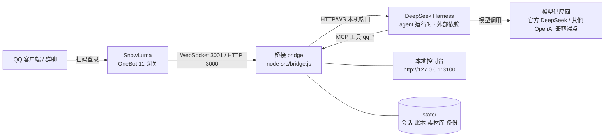

# 系统介绍：QQ ↔ DeepSeek Harness 桥接

> 面向「第一次拿到这个项目的人」：它是什么、能干什么、怎么装、数据放哪、出问题先看哪。
> 只想快速跑起来 → 看 [QUICKSTART.md](QUICKSTART.md)；想看每个目录/脚本干什么 → 看 [FOLDER_MAP.md](FOLDER_MAP.md)；素材库（BOOTH）的操作细节 → 看 [BOOTH-LIBRARY-GUIDE.md](BOOTH-LIBRARY-GUIDE.md)。

---

## 1. 它是什么

**一句话**：一个跑在自己电脑上的 QQ 机器人桥接——把 QQ（经 [SnowLuma](THIRD-PARTY.md) 的 OneBot 网关）接到 **DeepSeek Harness（DSH）** 的 agent 运行时上，让 AI 用「一个群友」的身份在群里/私聊里收发消息、看图看视频、发语音发图、学黑话、记事儿，并自带一个本地 Web 控制台。

- 不是 QQ 官方产品，也不是 DeepSeek 官方产品（见 [THIRD-PARTY.md](THIRD-PARTY.md)）。
- 一个 Node 进程（`node src/bridge.js`），控制台默认 `http://127.0.0.1:3100`。
- **DSH、SnowLuma、模型端点都不随包**，需要自己装（见 [EXTERNAL-DEPENDENCIES.md](EXTERNAL-DEPENDENCIES.md)）。

### 它能做什么（16 条，都能在控制台或文档里找到对应位置）

| # | 能力 | 说明 |
|---|---|---|
| 1 | QQ 群 / 私聊自动聊天 | 默认 `reserved2` 仿真模式：AI 自己判断回不回、什么时候潜水；@、叫名字、关键词、提问、拍一拍都能唤醒（`socialV2.wake`） |
| 2 | 主动说话 / 冷场接话 | 长时间没人说话会按概率开口（`socialV2.proactive`）；也可以连发几句（`socialV2.send.burst*`） |
| 3 | 看图、看视频 | 图片/表情/合并转发解析；视频抽帧 + 语音转写后交给模型（需要 ffmpeg，转写可选 faster-whisper） |
| 4 | 表情包 | 收藏群友表情、给自己的表情写备注、让 AI 自然发表情（`socialV2.sticker`） |
| 5 | 语音 | 发语音条（TTS / 预设语音库）、收语音转文字（STT，`socialV2.voice` / `socialV2.stt`） |
| 6 | 生图（两档） | 免费档不限次、高质量档按自然日计次（默认 30/天）；**两档都带「AI生成」标注**（法规要求），失败不会偷偷降档 |
| 7 | 记忆与检索 | 会话映射、群友印象/好感度、跨会话历史检索（`state/messages.db`） |
| 8 | 黑话 / 梗 | 从群聊里自动抽取候选、人工确认后注入提示词（`slang`，控制台可管理） |
| 9 | 人设与角色卡 | `roles/` 下的人格卡可在控制台编辑，保存即生效；不同会话可切不同预设（`qq-chat` / `qq-chat-v2`） |
| 10 | 名单与模型路由 | 私聊/群聊白名单、拒绝名单、主人 QQ；模型降级链、峰谷分时路由、看图轮自动切视觉模型（`allow` / `dsh.modelFallbacks` / `socialV2.modelRouting`） |
| 11 | token 用量与花费 | 账本记录每次调用的输入/输出/缓存 token，控制台「令牌与花费」按定价换算（`pricing`）；同一页的「工具消耗」卡还能看**各工具分别花了多少**（按轮均摊的近似，见 [guides/TOOL-TOKEN-USAGE.md](guides/TOOL-TOKEN-USAGE.md)） |
| 12 | BOOTH 素材库 | 本地素材档案管理：同步已购库、下载/暂停/续传、解压、以图搜源、认号（含可信度与一键认号）、重复素材、素材集、Unity 工程使用统计、读包内信息。细节见 [BOOTH-LIBRARY-GUIDE.md](BOOTH-LIBRARY-GUIDE.md) |
| 13 | 文件转存 | 群里的大文件自动转存到本地目录（上限、保留期、分类、清理时间都可配，`fileArchive`） |
| 14 | 控制台 + 访客只读 | 本机 Web 控制台（首页/会话/令牌/设置/人格/素材库等）；可发「访客令牌」给别人只看不改（白名单只读 + 敏感字段剥离） |
| 15 | 私聊加好友提示 | 对方不是好友时私聊只能发文字（表情/图片会被 QQ 拒），攒够条数后**在那条消息末尾**自然提一句、带冷却，不单独刷屏（`socialV2.private.addFriendHint`） |
| 16 | 纯净模式 / @ 命令 | 纯净模式砍掉记忆/表情/交接等上下文、只留人设与必要规则，实测提示词从约 5.7k 字降到约 2k 字；`/persona` 与 `@机器人 /persona …` 都能换人设。细节见 [guides/CONVERSATION-FEATURES.md](guides/CONVERSATION-FEATURES.md) |

> 另外可选：**联网搜索**（`webSearch`）、**观察学习**（从群里学黑话/表情，`observe`）、**桌面壳**（`desktop/`，Windows 托盘客户端，可托管桥接进程、开机自启、一键更新，见 [desktop-host.md](desktop-host.md)）。

---

## 2. 架构



要点：

- **桥接自己是一个普通 Node 进程**，负责白名单、会话、媒体、工具、仿真社交、文件转存、账本、控制台。
- **DSH 是外部依赖，不随包**：桥接通过 `config.dsh.baseUrl`（或自动发现本机端口）驱动它；桥接启动时 DSH 没起来也能启动，只是 `dshReady=false`，消息进不了模型。
- 桥接同时充当 DSH 的 **MCP server**（`src/mcp-*.js`），AI 通过 `qq_*` 工具操作 QQ（发消息、看图、发表情、发图、发语音、查历史…）。
- 数据全部落在本机 `state/` 目录，`config.json` 里有密钥，两者都不入库、不随包。

---

## 3. 目录结构

| 路径 | 是什么 |
|---|---|
| `src/` | 桥接内核：`bridge.js` 只做装配，业务在 `src/bridge/`（模块清单 `src/bridge/manifest.json`）；还有 DSH 客户端、三个 MCP server、黑话/表情/语音/素材库共享库 |
| `public/` | 控制台静态资源：`client.html`（`/client`）、`ops.html`（`/ops` 运维面板）、`library.html`（`/library` 库页）及其 css/js |
| `client/` | 控制台前端的源码分片（按功能分文件），构建产物是 `public/client.js` |
| `scripts/` | 测试与运维脚本：`test-*.mjs` 回归、`regression-all.mjs` 全量跑、`setup-doctor.mjs` 体检、打包/安装脚本 |
| `plugins/` | 要装进 DSH 的插件：`qq-mode-console`（`qq-mode` 设置命名空间）、`qq-agent-presets`（agent preset patch） |
| `dsh/` | 要装进 DSH 的 preset 权威源：`agent-presets/qq-chat`、`agent-presets/qq-chat-v2` |
| `docs/` | 全部文档（索引见 [README.md](README.md)）；`docs/images/` 是本文与根 README 用的截图 |
| `desktop/` | Windows 桌面壳源码（托盘、WebView2、托管桥接进程），构建脚本 `scripts/desktop/build-host.ps1` |
| `state/` | **运行时数据，不入库**：会话、账本、黑话、素材库索引、备份、锁、令牌、日志 |
| `roles/` / `audio/` / `assets/` | 人格卡 / 语音库 / 仓库用图片资源（`audio/` 是用户文件） |
| `config.json` | 真实配置（不入库）；模板 `config.example.json`；安装器模板 `config.template.json` |
| `AGENTS.md` / `RULES.md` | 改代码前的红线与权限边界（给贡献者看） |

---

## 4. 安装与第一次启动

### 4.1 前置条件

- Windows 10/11（主要在 Windows 上验证；macOS/Linux 未验证）
- **Node.js ≥ 22.13**（用到内置 `node:sqlite`）
- 一个可登录的 QQ 号
- 能访问模型 API 的网络

### 4.2 三个必须自己装的外部件

| 外部件 | 作用 | 怎么来 |
|---|---|---|
| SnowLuma | QQ 协议网关（OneBot 11，默认 WS 3001 / HTTP 3000） | 自己安装并扫码登录，开启 OneBot WebSocket 与 HTTP，记下 access token |
| DeepSeek Harness (DSH) | agent 运行时（会话 / preset / 工具） | 自行安装，然后把本项目的三个 MCP server 与 `qq-chat-v2` preset 注册进去（见 [guides/DSH_SETUP.md](guides/DSH_SETUP.md)，`scripts/setup-dsh.mjs` 可辅助） |
| 模型端点 | 真正生成回复 | 官方 DeepSeek / 小米 MiMo / WorkBuddy2API / 本地 ollama 均可，在 DSH 侧配好 |

可选：ffmpeg（视频抽帧、HEIC 转换）、Python + faster-whisper（语音转写）。

### 4.3 从源码跑（Windows PowerShell）

```powershell
# 1) 装依赖 + 生成 config.json（照 config.example.json 复制）
powershell -NoProfile -ExecutionPolicy Bypass -File scripts\bootstrap.ps1

# 2) 体检（逐项给 ✅/⚠️/❌ 和修复命令）
node scripts\setup-doctor.mjs

# 3) 填 config.json 里 4 个值：snowluma 三个 + dsh.baseUrl/provider/model + allow.groups + ownerQQ
# 4) 启动
npm start            # 等价于 node src\bridge.js
```

启动日志里应依次看到：

```
SnowLuma 已连接：ws://127.0.0.1:3001
DSH 已就绪（模式: reserved2）
本地控制台已启动：http://127.0.0.1:3100
```

然后打开 `http://127.0.0.1:3100/?token=<state/console-token 里的值>`。令牌文件是 `state/console-token`，丢了删掉重启会重新生成。

### 4.4 Windows 一键安装包（可选）

`dist/` 里如果提供了 `QQDeepSeekBot-Setup-<版本>.exe`：

1. 双击安装（默认装到 `%LOCALAPPDATA%\QQDeepSeekBot`，可选开机自启——**默认不勾**）；
2. 安装程序会生成 `config.json`、创建快捷方式、并在后台尝试启动桥接（日志在安装目录 `logs\`）；
3. 首次运行仍需自己填 `config.json` 里的 4 个值，并装好 SnowLuma / DSH；
4. **二次安装是「合并覆盖」**：已有的 `config.json` 与 `state/`（记忆、素材库、账本）不会被覆盖或删除，卸载时才会删目录。

桌面壳（托盘客户端）用法见 [desktop-host.md](desktop-host.md)：打开界面、启动/重启/停止桥接、看状态、开机自启。

---

## 5. 配置速查表

> 全量字段说明见 [CONFIG-FIELDS.md](CONFIG-FIELDS.md)；这里只列最常改的。默认值以 `config.example.json` 为准。

| 配置段 | 关键项（默认值） | 改了会怎样 |
|---|---|---|
| `allow` | `private: []`、`groups: []`；`allowAllWhenEmpty: false` | 留空 = 谁都不理；`allowAllWhenEmpty` 改成 true = 接受所有会话（不建议） |
| `ownerQQ` | `null` | 主人 QQ：部分敏感操作/通知只认这个号 |
| `deny` | `private: []`、`groups: []` | 拒绝名单优先于白名单 |
| `dsh` | `baseUrl: http://127.0.0.1:3080`、`provider: deepseek-official`、`model: deepseek-flash`、`reasoningEffort: max`、`modelFallbacks: [...]` | 决定用哪个模型、失败后怎么降级；`visionModels` 决定哪轮可以看图 |
| `socialV2` | `enabled: true`、`wake.defaultMode: diving`、`send.maxSendPerHour: 60`、`sticker/voice/stt` 子段 | 控制仿真社交的「话量」与工具面；`tools.*` 是逐个工具开关（约 30 个） |
| `social` | 一代仿真（`reserved` 模式用） | 默认模式已是 `reserved2`，一般不用动 |
| `imagegen` | `enabled: true`、`mode`、`endpoint`、`cooldownMs: 45000`、`maxPerHour: 10` | 免费档/高质量档的服务与限速；高质量档另有按日配额（默认 30/天） |
| `fileArchive` | `enabled: false`、`dir: state/files`、`maxFileMb: 2500`、`retention.*`、`cleanupHour: 4` | 群里文件自动转存；开启后注意磁盘与保留期 |
| `library` | `autoExtract`、`extractKeepZip` | 素材库：下载完是否自动解压、解压后是否保留 zip |
| `consolePort` | `3100` | 控制台端口；被占用时改这里并重启 |
| `consoleToken` | `""` | 控制台固定令牌；留空则用 `state/console-token` 随机令牌 |
| `pricing` | 每个模型 `off.{cacheHit, cacheMiss, output}` | 控制台「令牌与花费」的计价口径 |
| `webSearch` | `provider: auto`、`maxUses: 5` | 联网搜索工具的次数与来源 |
| `observe` | `enabled: false`（`learnSlang` / `learnStickers`） | 从群聊里学黑话/表情（有隐私与成本开销） |

改完配置的方式：**重启桥接**（`src/` 改动必须重启；配置读盘后生效），或在控制台设置页保存（部分项支持热更新，见 [HOT-RELOAD.md](HOT-RELOAD.md)）。

---

## 6. 数据与隐私

**哪些是用户数据（都在本机，不入库、不随包）**

| 位置 | 内容 |
|---|---|
| `config.json` | 群号/QQ 号/令牌/模型 key（明文，只在本机） |
| `state/sessions.json` | 会话 ↔ DSH 会话映射 |
| `state/messages.db` | 消息库（聊天记录、检索用） |
| `state/people.json` / `affinity.json` / `member-notes.json` | 群友档案、好感度、备注 |
| `state/slang.json` / `stickers.json` | 黑话库、收藏表情索引 |
| `state/social-v2.json` / `current-role.json` / `mode.json` | 仿真社交状态、当前人格、当前模式 |
| `state/booth-*.json`、`state/library-*.json` | BOOTH 素材库台账、绑定、已购、素材集、解压记录、别名规则 |
| `state/console-token` | 控制台令牌 |
| `state/backups/` | 上面这些 JSON 的**定时备份**（默认每 2 小时增量，每文件留 24 份 + 每天首份留 14 天） |
| `logs/`、`state/*.log` | 运行日志 |

**隐私承诺**

- 密钥、令牌、QQ 号、群号 **只存本地**，不上传、不随包；控制台和 API 不回显令牌（访客模式下敏感字段直接剥离）。
- 群友数据（聊天记录、图片、语音、印象）视为群友数据，**不对外发布**；转交项目前先删 `state/`、`logs/`、`config.json`（见 [THIRD-PARTY.md](THIRD-PARTY.md) §5）。
- 访客只读模式：给别人的是一个 `?guest=<令牌>` 链接，只能看首页状态、素材卡与封面、文件清单、找号结果等只读内容，不能改任何东西。
- 备份不含凭据：`booth-cookies.json`（BOOTH 登录态）与解压密码本 **永不进备份**。

---

## 7. 常见问题（10 条）

| 现象 | 先看这里 |
|---|---|
| 生图提示没 key / 出图失败 | 出图要配 `imagegen.endpoint` 或对应服务凭据；免费档也需要出图服务可达（见 `docs/FIXES.md` 里两档语义） |
| 私聊发不了图片 | QQ 对「临时会话」有限制，发图片要求已是好友/正式会话；群里不受此限 |
| 报 429 / 冷却中 | 上游或本地限速：`imagegen.cooldownMs`、`maxPerHour`；BOOTH 侧有 900ms/页限速，控制台会显示暂停倒计时 |
| 已购库同步「只同步到 200 件」 | 旧版上限；现在按页翻（默认 20 页、最多 50 页，每页 ≥900ms），见 [BOOTH-LIBRARY-GUIDE.md](BOOTH-LIBRARY-GUIDE.md) §10 |
| 素材名字对不上 | 文件名不可靠：认号优先看**目录名里的 BOOTH 号**，其次才是标题相似度/绑定表（同上 §3、§17） |
| Unity 导入提示没有工程目录 | 在素材库「工程使用统计」里配扫描根（一行一个目录，靠 `ProjectSettings/ProjectVersion.txt` 认工程） |
| DSH 没起来 / 完全不回消息 | 桥接能启动但 `dshReady=false`；先确认 DSH 在跑、`dsh.baseUrl` 对得上，然后重启桥接 |
| 端口被占用（启动即退出） | 控制台 `consolePort`（默认 3100）、SnowLuma 3000/3001、DSH 端口，改一个或先关掉占用进程 |
| 控制台令牌丢了 / 打不开 | 令牌在 `state/console-token`；删掉它重启会重新生成，或用 `config.consoleToken` 固定 |
| 怎么升级到新版本 | 覆盖安装即可：安装器是合并覆盖，`config.json` 与 `state/` 保留；源码用户拉新代码后 `npm ci` 再重启 |
| 日志显示「SnowLuma 已连接」但群里一条消息都不来 | 这是 SnowLuma 的 `[Hook]` 退化（它的进程与 WebSocket 都活着，但收不到 QQ 数据）。桥接会在 `GET /api/status` 的 `snowluma` 字段与「运行总览」的 `SnowLuma 上游` 卡片报 `degraded`；再去看 SnowLuma 自己的日志里有没有 `receive path stale`。详见下面 §7.1 |

### 7.1 SnowLuma 的几个已知行为（不是本项目的 bug）

1. **首次连接几乎必然失败一次**：SnowLuma 的 HTTP token（3000）与 WS token（3001）是两个不同的值，而 `snowluma.accessToken` 通常只存 HTTP 那个。所以启动时日志会出现 `SnowLuma 连接断开（code=1006）` → 自愈 WS token → 再打出 `SnowLuma 已连接`。**这条序列是正常的**；一直连不上则是自愈无从下手（`snowluma.homeDir` 没配/指错、读不到 `config/onebot_<QQ号>.json`）。
2. **端点自愈会写回 `config.json`**：换 QQ 账号后端口/token 会变，桥接连不上时会重新发现端点并写回配置。想跑第二份实例或指向别处的 SnowLuma，设 `"snowluma": { "followDiscoveredEndpoint": false }`——关掉后只自愈 token，不动 URL。
3. **版本要求**：SnowLuma 运行时在 **1.14.20** 实测（1.14.9 兼容）；`@snowluma/sdk` 已钉 `^1.14.20`。升级运行时**不会**更换它注入 QQ 用的原生组件，所以「原生 hook 挂不上 QQ」这类问题只能走 SnowLuma 自己的排查。
4. 桥接自身**没有任何原生注入面**（纯 JS 依赖，没有 `.dll` / `.node` / FFI / 进程注入），也不启动、不控制 SnowLuma 或 QQ。


---

## 8. 已知限制

- **只在 Windows 10/11 上完整验证**；macOS/Linux 能跑 Node 部分，但启动脚本、路径、桌面壳、部分工具未验证。
- **单实例**：同一份数据目录只应跑一个桥接进程（有锁文件 `state/bridge.lock`）。
- **DSH 不随包**，且其许可待确认——要给别人用，请让对方自己装 DSH。
- **BOOTH 相关功能需要登录 Cookie**（或扫码登录后写入 Cookie）；登录态过期就要重新登录。
- **BOOTH 购买日期抓不到**：已购清单能拿到商品信息，但下单日期无法稳定获取。
- **加密压缩包目前只支持 ZipCrypto**：AES 加密的包会被拒绝，需要用 7-Zip 手动解。
- 素材库**以本机档案目录为准**：文件不在本机时只能看到台账记录（封面可能缺失）。
- 生图两档都带「AI生成」标注（法规要求），不能去标注。
- 访客只读模式**只能看**，不能下载/改绑定/同步；写接口一律 403。
- 控制台/工具的默认端口假设本机单用户；不要直接暴露到公网（`allowRemote` 默认关闭）。
- **回复不是流式的**：agent 的回复在回合结束时一次性发出；超过 `socialV2.send.maxMessageChars`（默认 500 字）会按句读/URL 边界自动分段。
- **收语音目前只显示占位文本**（不做语音转写进上下文，除非开了 STT 链路）；发语音支持，但 **AI 发语音默认关闭**（`socialV2.voice.enabled` 与工具开关默认 `false`），要先把音频放进 `audio/` 再到控制台打开。
- 图片与部分表情能接入多模态模型；无法取得字节的消息仍用占位文本。
- agent 的 Markdown 回复会转成纯文本（链接保留 `文字 (url)` 形式）。
- `@snowluma/sdk` 的 npm 发布版有 ESM 扩展名 bug，本项目用 postinstall 补丁修（`scripts/patch-snowluma-sdk.mjs`）。


---

## 9. 致谢与第三方许可

本项目（qq-bridge）采用 **MIT**（见 [LICENSE](../LICENSE)）。**第三方组件不随包**，各自遵守原许可：

| 组件 | 用途 | 许可/边界 |
|---|---|---|
| [DeepSeek Harness (DSH)](THIRD-PARTY.md) | agent 运行时（外部依赖） | **许可待确认** → 不随包、不代装 |
| [SnowLuma](THIRD-PARTY.md) | QQ 协议网关（OneBot 11） | **SnowLuma Source-Available Non-Commercial License v1.0**：允许非商业再分发（须附许可全文/保留版权），修改版公开发布需书面许可，禁商业使用 |
| WorkBuddy2API（可选） | OpenAI 兼容中转 | AGPL-3.0，不随包 |
| Node.js | 运行时 | MIT 系 |
| ffmpeg / ffprobe（可选） | 抽帧、转码 | 具体构建可能是 GPL，随包需履行 GPL 义务 → 本项目不随包 |
| Python + faster-whisper（可选） | 语音转写 | MIT |
| ollama + qwen3（可选） | 本地兜底模型 | MIT / Apache-2.0 |
| 本地 RVC TTS（可选） | 音色合成 | 音色涉及真人声音权利，不随包 |

我们**只分发自己的代码与人设**；QQ 号、群号、模型 key、控制台令牌、DSH 登录态全部由使用者自己产生。再分发/商用前请先读 [开源说明.md](开源说明.md)。

---

## 10. 想进一步了解

| 我想…… | 看这个 |
|---|---|
| 5 分钟跑起来 | [QUICKSTART.md](QUICKSTART.md) |
| 看全部配置项 | [CONFIG-FIELDS.md](CONFIG-FIELDS.md) |
| 看每个目录/脚本职责 | [FOLDER_MAP.md](FOLDER_MAP.md) |
| 用 BOOTH 素材库 | [BOOTH-LIBRARY-GUIDE.md](BOOTH-LIBRARY-GUIDE.md) |
| 在外网/新设备把桥接接进 DSH | [guides/DSH_SETUP.md](guides/DSH_SETUP.md) |
| 安全边界与威胁模型 | [guides/SECURITY_BASELINE.md](guides/SECURITY_BASELINE.md)、[../RULES.md](../RULES.md) |
| 改代码前要知道的坑 | [../AGENTS.md](../AGENTS.md)、[LESSONS.md](LESSONS.md) |
| 许可证与再分发 | [开源说明.md](开源说明.md)、[THIRD-PARTY.md](THIRD-PARTY.md) |
